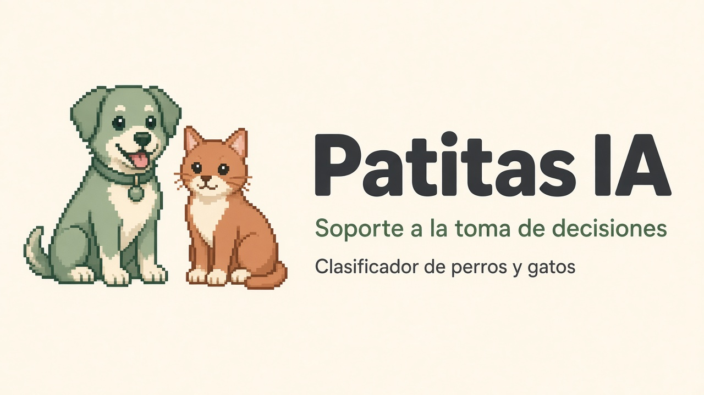
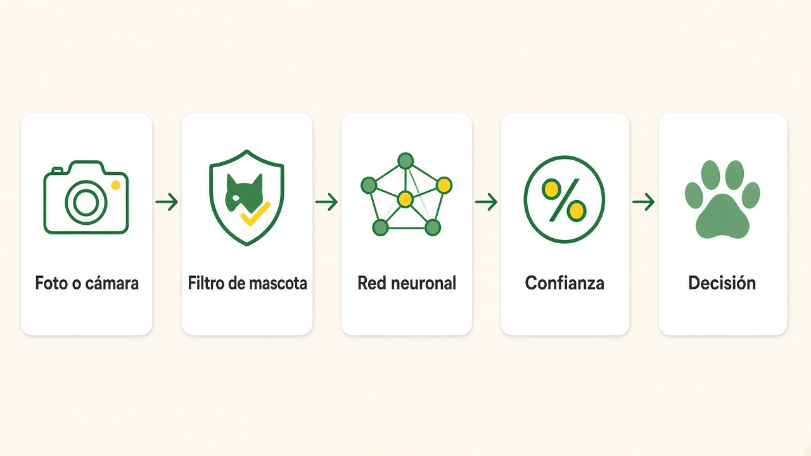
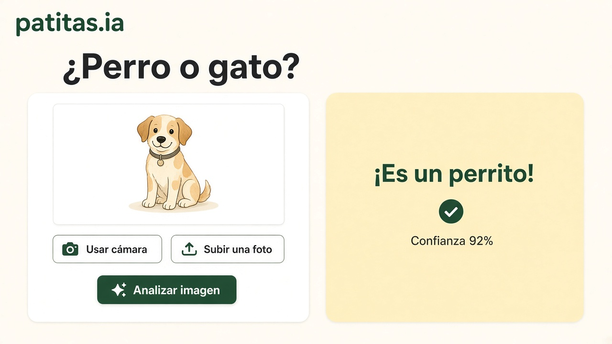
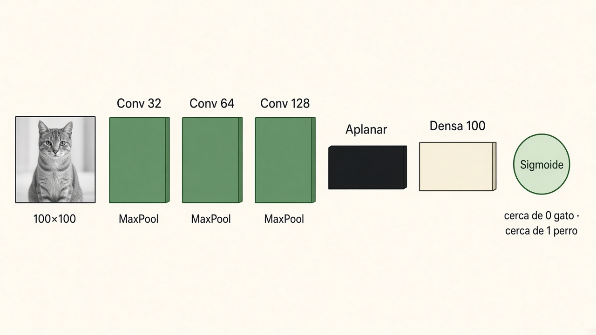
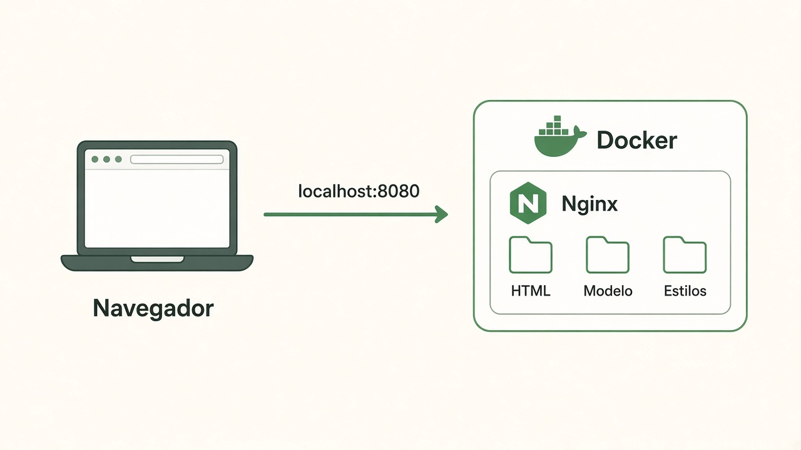

# Patitas IA

Sistema de apoyo a la toma de decisiones que clasifica una foto como **perro** o **gato**.

| | |
|---|---|
| **Materia** | Soporte a la toma de decisiones |
| **Docente** | Jesús Bautista |
| **Alumno** | Luishiño Pericena |
| **Producto** | Aplicación web estática, modelo de visión y contenedor Docker |



La persona aporta la foto. El sistema comprueba que haya una mascota, estima la clase y muestra un porcentaje de confianza. La decisión final sigue siendo de quien usa la aplicación: si la confianza es baja, el resultado se marca como poco seguro.

No hace falta Node.js. La página, los estilos y el modelo ya están listos. Docker solo levanta Nginx para servir esos archivos.

---

## 1. Qué decisión apoya

El problema es binario: ante una imagen, decidir si el animal es un perro o un gato.

Patitas IA no reemplaza el criterio de la persona. Ordena la evidencia en cuatro pasos:

1. Rechaza fotos que no muestran un perro ni un gato (personas, objetos, escenas vacías).
2. Calcula una probabilidad con la red neuronal entrenada.
3. Traduce esa probabilidad a una etiqueta y a un porcentaje de confianza.
4. Guarda el resultado en el mismo dispositivo para poder revisarlo después.



Si la confianza queda por debajo del 60 %, la interfaz avisa que el resultado es poco seguro. Eso evita tratar una estimación débil como si fuera un hecho.

---

## 2. Cómo se usa



1. Abre la aplicación.
2. Sube una imagen (JPG, PNG, WEBP o GIF, hasta 12 MB) o enciende la cámara.
3. Pulsa **Analizar imagen**.
4. Lee la clase, la confianza y, si quieres, escucha el resultado en voz alta.
5. Revisa el historial de las últimas detecciones. Se puede borrar en cualquier momento.

La foto no se envía a un servidor. El historial guarda solo la etiqueta, la confianza y la fecha, dentro del navegador.

---

## 3. El modelo de inteligencia artificial

El clasificador que corre en la página es una **red neuronal convolucional** llamada `patitas_classifier`. Se entrenó en el cuaderno `entrenamiento/Clasificador_de_perros_y_gatos.ipynb` y se exportó a TensorFlow.js.



### Datos

| Dato | Valor |
|---|---|
| Conjunto | `cats_vs_dogs` de TensorFlow Datasets (fotos de Microsoft / Kaggle) |
| Imágenes | 23 262 |
| Tamaño de entrada | 100 × 100 píxeles, un canal en escala de grises |
| Entrenamiento | 19 700 imágenes |
| Validación | 3 562 imágenes |
| Aumento de datos | Giro, desplazamiento, recorte, zoom y volteo horizontal y vertical |

La salida usa **sigmoide**, un número entre 0 y 1:

- cerca de **0** → gato
- cerca de **1** → perro

En la página, si el valor es 0,5 o menor se muestra **Gato**; si es mayor, **Perro**. La confianza es la probabilidad de la clase elegida.

### Capas

El archivo `web/modelo/model.json` describe esta secuencia:

| Capa | Qué hace |
|---|---|
| Entrada `100×100×1` | Recibe la foto ya en gris y normalizada entre 0 y 1 |
| Convolución, 32 filtros 3×3, ReLU | Busca bordes y texturas simples |
| MaxPool 2×2 | Reduce el tamaño y se queda con lo más marcado |
| Convolución, 64 filtros 3×3, ReLU | Combina esas marcas en formas |
| MaxPool 2×2 | Vuelve a comprimir |
| Convolución, 128 filtros 3×3, ReLU | Arma rasgos más específicos del animal |
| MaxPool 2×2 | Última reducción espacial |
| Aplanar | Convierte el mapa en un vector |
| Densa, 100 neuronas, ReLU | Relaciona esos rasgos |
| Densa, 1 neurona, sigmoide | Entrega la probabilidad perro/gato |

Los pesos viven en `web/modelo/group1-shard1of2.bin` y `web/modelo/group1-shard2of2.bin`, al lado de `model.json`.

### Cómo se entrenó

En el cuaderno se compararon tres ideas: una red densa, esta red convolucional y una convolucional con dropout. La que se publicó es la convolucional con aumento de datos (`modeloCNN_AD`).

- Optimizador: Adam
- Pérdida: entropía cruzada binaria, porque solo hay dos clases
- Métrica: exactitud
- Lotes de 32 imágenes
- 150 épocas sobre las imágenes aumentadas
- Se guardó como `perros-gatos-cnn-ad.h5` y se convirtió con `tensorflowjs_converter`

El cuaderno navegable está en la propia aplicación: `web/cuaderno/Clasificador_de_perros_y_gatos.html`.

### Qué ocurre al pulsar Analizar

Hay dos modelos, y cumplen papeles distintos.

1. **Filtro.** COCO-SSD con MobileNet v2 mira la imagen a 400×400. Solo sigue adelante si detecta `dog` o `cat` con puntuación de al menos 0,25. Si ve una persona con puntuación de al menos 0,40 y no hay mascota, la foto se rechaza.
2. **Clasificador propio.** La misma imagen se reduce a 100×100, se pasa a gris con los pesos del cuaderno (`0,114` azul, `0,587` verde, `0,299` rojo) y se divide entre 255. `model.predict` devuelve la sigmoide.

El filtro viene de un CDN la primera vez. El clasificador propio se carga desde `web/modelo/`.

---

## 4. La página HTML

Todo lo que ve la persona está en `web/`. Es un sitio estático: HTML y un script dentro de `index.html`. No hay servidor de Node.

Tailwind se carga en el navegador y lee las clases escritas en el HTML (`bg-cream`, `flex`, `max-w-6xl`, los colores propios y el resto). Así el diseño se aplica sin compilar nada. `styles.css` solo guarda lo que Tailwind no cubre.

| Pieza | Función |
|---|---|
| `web/index.html` | Pantalla, cámara, carga de foto, clasificación, voz e historial |
| `web/styles.css` | Detalles propios: píxeles, foco, cámara y títulos en móvil |
| `web/service-worker.js` | Permite instalar la app y reutilizar archivos sin conexión |
| `web/manifest.webmanifest` | Nombre, color e icono de la aplicación instalable |
| `web/assets/` | Ilustración, iconos y favicon |
| `web/modelo/` | Topología y pesos del clasificador |
| `web/cuaderno/` | Explicación navegable del entrenamiento |

TensorFlow.js y el detector COCO-SSD se piden por CDN. Por eso la **primera** visita necesita internet. Después, el service worker puede guardar esos recursos.

La cámara pide permiso al navegador y funciona en `localhost` o con HTTPS. Si no hay cámara, siempre se puede subir una foto.

---

## 5. Docker

Docker empaqueta la carpeta `web/` dentro de Nginx. El navegador habla con el puerto **8080**. Nginx entrega el HTML, el modelo y los estilos. No instala Node ni entrena nada.



| Archivo | Función |
|---|---|
| `docker/Dockerfile` | Imagen `nginx:1.27-alpine`. Copia `web/` a `/usr/share/nginx/html` |
| `docker/nginx.conf` | Escucha en el 8080, comprime texto y JSON, y define caché |
| `compose.yaml` | Construye la imagen y publica `8080:8080` |
| `.dockerignore` | Deja fuera el cuaderno, las fotos del README y `node_modules` |

Nginx añade cabeceras para no mezclar el sitio en un iframe ajeno y para permitir la cámara solo en esta misma página. Los pesos `.bin` se cachean un año porque no cambian. `model.json` se cachea una hora. La página y el service worker no se quedan pegados en caché, para que una actualización se note al recargar.

Hay un chequeo de salud: cada 30 segundos Nginx pregunta si la página de inicio responde.

### Arrancar

Con [Docker](https://docs.docker.com/get-docker/) instalado, en esta carpeta:

```bash
docker compose up --build
```

Abre [http://localhost:8080](http://localhost:8080).

Para detenerlo: `docker compose down`.

### Sin Docker

Cualquier servidor estático de la carpeta `web/` sirve. Un ejemplo con Python, sin instalar Node:

```bash
python -m http.server 8080 --directory web
```

No abras `index.html` con doble clic. La cámara, el modelo y el service worker necesitan una dirección `http://`, no `file://`.

---

## 6. Carpetas

```text
.
├── README.md                 Esta guía
├── compose.yaml              Arranque con Docker
├── .dockerignore
├── docker/
│   ├── Dockerfile
│   └── nginx.conf
├── docs/
│   └── imagenes/             Fotos de esta documentación
├── entrenamiento/
│   └── Clasificador_de_perros_y_gatos.ipynb
└── web/                      Lo que ve el navegador
    ├── index.html
    ├── styles.css
    ├── service-worker.js
    ├── manifest.webmanifest
    ├── assets/
    ├── modelo/
    │   ├── model.json
    │   ├── group1-shard1of2.bin
    │   └── group1-shard2of2.bin
    └── cuaderno/
        └── Clasificador_de_perros_y_gatos.html
```

---

## 7. Límites de la decisión

- Una foto oscura, borrosa o con varias mascotas puede fallar.
- El filtro previo también se equivoca: a veces deja pasar algo que no es mascota, o frena una foto válida.
- La confianza es una estimación del modelo, no una certeza.
- El historial permanece solo en ese navegador. Borrar los datos del sitio lo elimina.
- El proyecto es educativo. Sirve para apoyar una clasificación sencilla, no para un diagnóstico ni para identificar una mascota concreta.
